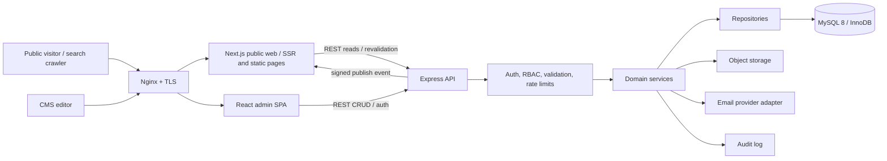
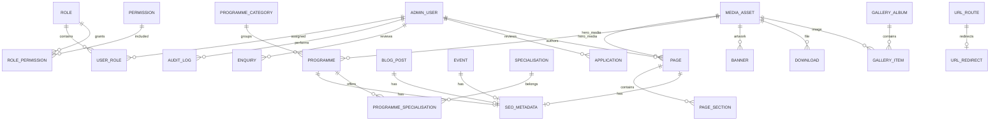
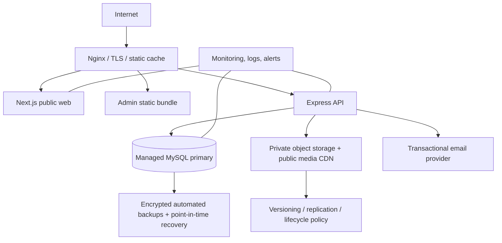

# VS Medu Website Redevelopment: Architecture Proposal

**Status:** Draft for stakeholder review  
**Prepared:** 30 October 2026  
**Scope:** Architecture and foundation planning only. No Figma UI implementation, production data migration, infrastructure provisioning, or destructive changes are included.

## 1. Executive recommendation

Build a **modular monolith** in a TypeScript monorepo: a server-rendered React public site using **Next.js**, a separate React-based admin application, and a versioned **Express REST API** backed by **MySQL 8 / InnoDB**. Use Prisma schema migrations and typed repositories/services for persistence. Keep the public website, admin and API deployable as separate processes while sharing types and validation contracts. Use server rendering or static generation with on-demand revalidation for public content; do not ship an SEO-dependent brochure site as client-only React.

This preserves the requested React, Node.js, Express and MySQL stack while adding a React rendering framework that provides crawlable HTML, route-level metadata, sitemap generation, image optimization, and caching. Next.js is the web rendering layer, not a second business API: all reads and mutations go through Express REST. The admin app remains a private SPA. This recommendation should be confirmed before implementation, particularly hosting constraints and content editorial workflow.

The live-site inspection indicates a substantial content platform, not a single landing page: institutional pages, two programme tracks, five specializations, admissions/application forms, disclosure documents, faculty, placement data, events, galleries, video/speaker content, testimonials, FAQs, and blog posts. The accessible navigation is duplicated in rendered page text, and the live content contains inconsistent claims and apparent text/layout defects. Preserve source content and URLs first; reconcile content accuracy with the institution before publishing a cleaned version.

## 2. Inspection findings and limits

Inspected `https://vsmedu.com/` and the pages linked from its primary navigation on 30 October 2026. The site identifies Valia School of Management, exposes the contact details `info@vsmedu.in`, `+91 730 434 3478`, and `+91 730 434 3460`, and presents the page families in the inventory below. Homepage sections include a hero/slider, metric claims, institute overview, PGDM introduction and specialization cards, faculty, differentiators, recruiter logos, event highlights, internship imagery, student video testimonials, written testimonials, and FAQs.

The admissions application page exposes a substantial multi-section form: personal details, address, education history (10th/12th/graduation), entrance exam scores, referral source, and consent. Admissions and event pages also expose shorter enquiry forms. The contact pages expose address, opening hours, phone and email. The public text does not establish how submissions are stored, routed, or retained; current enquiry integration and existing enquiry access must be confirmed with the site owner.

### Page and URL inventory observed from navigation

The table records canonical-looking URLs returned by the site for observed links. It is an initial inventory, **not a verified exhaustive crawl**. Redirects, aliases, query-string URLs, pagination, hidden pages, post detail pages, and URLs omitted from navigation remain to be inventoried from the site's sitemap/CMS/export and server logs.

| Content family | Observed page / URL | Structure or notes |
|---|---|---|
| Home | `/` | Hero; proof points; overview; PGDM and specializations; faculty; benefits; recruiters; events; internship; video and text testimonials; FAQ. |
| About | `/about-us/about-vsm-mba-pgdm-colleges-in-mumbai/` | Overview, vision and mission. |
| About | `/about-us/our-philosophy/` | Navigation item; fetch timed out in crawl. |
| About | `/about-us/academic-advisory-board/` | Board profiles. |
| About | `/about-us/trustee-message/` | Trustee and society messages. |
| About | `/about-us/vice-chairman-message/` | Leadership message. |
| About | `/about-us/director-message/` | Leadership message. |
| About | `/about-us/affiliation-industry-leadership/` | Affiliations/industry leadership. |
| About | `/about-us/infrastructure/` | Facilities. |
| About | `/?page_id=415` | Student Residence nav item; crawl cache miss. Preserve query URL until actual canonical destination is verified. |
| Governance / disclosures | `/board-of-governance/` | Listed in navigation; not independently fetched. |
| Academics | `/our-academics/aicte-pgdm-courses-in-mumbai/` | AICTE PGDM overview and course details. |
| Academics | `/our-academics/aima-pgdm/` | AIMA PGDM track. Verify active status and meaning with owner. |
| Academics | `/faculty/` | Faculty listing/profile content. |
| Disclosure | `/anti-ragging-policy/` | Policy page. |
| Disclosure | `/committee/` | Committee information. |
| Disclosure | PDF link `EOA-Report-2026-27-1.pdf` | AICTE EOA document; direct PDF cache miss. Capture exact source URL and validate file during migration. |
| Admissions | `/admissions/mba-pgdm-admissions-process/` | Eligibility, process steps, enquiry form. |
| Admissions | `/admissions/pgdm-fee-structure/` | Fee information; verify current session/year and authoritative value. |
| Admissions | `/admissions/application-form/` | Long application form; privacy policy link and consent. |
| Admissions | `/admissions/refund-policy/` | Refund policy. |
| Placements | `/placements/our-recruiters/` | Recruiter logos/list. |
| Placements | `/placements/placement-records/` | Placement outcomes/records. |
| Placements | `/connect-with-us/` | Navigation labels this as Connect With Us; includes contact details. |
| Events | `/events/` | Event landing page; separate older footer/navigation structure, enquiry and brochure form, and payment link. |
| Gallery | `/events/gallery/` | Photo gallery. |
| Campus corporate connect | `/list-of-speakers/` | Navigation item; crawl cache miss. |
| Campus corporate connect | `/videos-of-speakers/` | Speaker/video content. |
| Events | `/events/achievements/` | Achievements. |
| Career | `/career/` | Navigation item; crawl timed out. |
| Blog | `/blogs/` | Blog listing; multiple article links. |
| Contact | `/contact-us/` | Contact details and opening hours. |
| Additional linked pages | Student testimonials, specializations, event detail pages, privacy policy, application terms, payment provider | Linked from page content or older event footer; exact canonical URLs and full page set need crawler/sitemap verification. |

### Reusable content structures observed

- Shared two-tier header/contact bar and footer/navigation (some legacy sections differ).
- Breadcrumb and title/banner regions on inner pages.
- Flexible content page with text, image, callout, profile, list, document and FAQ sections.
- Programme overview with specializations, eligibility, duration, fees, curriculum, CTA and related downloads.
- Profile directory for faculty, trustees, board members and speakers.
- Listing/detail pairs for blogs, events, achievements, gallery albums and possibly videos.
- Media assets and document downloads with captions, alt text, date, type and placement.
- Enquiry form with source attribution and consent; separate long admission application with education and entrance score groups.
- Recruiter/partner logos, student testimonials, metric/proof-point blocks and FAQ groups.

### SEO and content quality signals

Titles and descriptive H1s are exposed on fetched pages, and the site has readable descriptive slugs and internal navigation. A complete audit of meta descriptions, canonical tags, schema, robots directives, XML sitemap and redirects was not possible: `robots.txt`, `sitemap_index.xml` and `wp-sitemap.xml` were inaccessible to the available crawl tool. The site appears to use WordPress based on URL conventions, but CMS access has not been supplied, so this is an inference and not a confirmed implementation detail.

The crawl reveals quality risks to resolve during content sign-off: homepage counters were extracted as zero; an older events page has a visibly different navigation/footer; the Connect With Us email text is concatenated in the extracted page; and internship durations/placement statements differ across pages (including 3 months, 6 months and 6–8 months). These may be extraction defects, stale copy, or live-site inconsistencies. Confirm the intended facts with content owners rather than silently normalizing them.

**Inaccessible/incomplete:** philosophy page timed out; student-residence URL returned a cache miss; EOA PDF was not retrievable; list-of-speakers returned a cache miss; career page timed out; sitemap and robots files were not accessible. Many nested pages were identified from navigation but not individually opened. No complete asset inventory, form submission behavior, current enquiry database, WordPress admin export, analytics, server redirects, or source code was available. These are explicit discovery tasks before migration, not completed findings.

## 3. Technology decisions

| Area | Recommendation | Reason / boundary |
|---|---|---|
| Language | TypeScript across web, admin and API | Shared schemas and compile-time checks reduce contract drift in a multi-app codebase. Enable strict mode; validate untrusted runtime inputs separately. |
| Public frontend | Next.js App Router (React, Node deployment) | SSR for current programme/admissions content and metadata; static rendering for stable pages; on-demand revalidation for published CMS changes. Browser interactions hydrate selectively. |
| Admin | React + Vite + TypeScript SPA | Private authenticated interface; no public SEO need; quicker independent admin workflow. |
| API | Node.js LTS + Express 5 + TypeScript REST API | Retains requested Express architecture and a single business/API boundary. Pin an actively supported Node LTS at project start. |
| Database | MySQL 8.x, InnoDB, `utf8mb4`, UTC timestamps | Relational integrity for content, programmes, roles, enquiry records, redirects and media references. |
| ORM/migrations | Prisma schema + reviewed SQL migrations | Typed access and migration history. Keep data backfills explicit and review generated SQL for key, index and FK behavior. |
| Validation/contracts | Zod schemas in `packages/contracts` | Same request/response constraints can be used in admin and API; server validation remains authoritative. |
| CSS | CSS Modules plus global custom properties/tokens | Component styles without imposing a visual language. Add actual design tokens from approved Figma later; no page design is specified here. |
| File storage | Private object storage for originals; public CDN/optimized derivatives for published media | Keep file bytes out of MySQL; store metadata and stable storage keys in DB. Provider is a deployment decision. |
| Email | Provider adapter behind a service | Submission success must not depend on synchronous mail delivery; retry and alert on failures. Select provider after operations review. |
| Deployment | Nginx reverse proxy; separate web/admin/API Node processes; PM2 or systemd | Simple single-region modular monolith with clear process boundaries and rollback. |

### Rendering approach evaluation

Client-only React (for example a Vite public SPA) would make content discovery, initial page metadata, and robust social previews depend on client JavaScript or extra prerendering infrastructure. A plain Express-rendered React app could render HTML, but would require the team to build and maintain routing, metadata, static generation, image handling and invalidation machinery. A full-stack Next.js-only architecture would be capable, but would duplicate or replace the expressly requested Express REST backend and blur the intended API boundary.

**Recommendation:** Next.js renders the public React site and calls the Express API from the server for content; Express owns business rules, CMS data, forms and persistence. Use static generation for stable pages and server rendering for request-specific/dynamic pages. Publish events from Express trigger signed revalidation requests for affected public paths/tags; default cache durations are a fallback, not the correctness mechanism. Admin calls Express directly. This keeps crawlable HTML and metadata while preserving the requested Express backend. Validate the added deployment process and Next.js operational familiarity at kickoff.

## 4. Overall system architecture



Use one codebase and one relational database initially. Separate process boundaries permit independent scaling and deploys without introducing microservices, message brokers or Redis prematurely. Add Redis only when measured session/cache/queue needs justify another operational dependency. For high availability, use managed MySQL and object storage, with backups and restore drills.

## 5. Frontend architecture foundation

Public route families: `/`, `/about/[slug]`, `/academics/[slug]`, `/programmes/[slug]`, `/admissions/[slug]`, `/placements/[slug]`, `/events/[slug]`, `/gallery/[slug]`, `/blogs/[slug]`, `/contact`, and explicit policy/disclosure routes. Final paths must be mapped from the source URLs, not assumed from these proposed route families. Prefer static generation and tag/path revalidation for CMS-published pages; use dynamic rendering only where request context changes the output. Return a real 404 for missing/withdrawn pages and preserve redirects from old slugs.

Create shared site and admin shells, route-level error/loading boundaries, accessible form controls, a typed API client, and reusable content section renderers. Keep page composition data-driven for repeatable CMS blocks but allow explicit React templates for high-value page types such as admissions and programme detail. Do not make the CMS a free-form arbitrary component builder.

Suggested foundation tokens (names only, values after approved design): `--color-brand-*`, `--color-text-*`, `--color-surface-*`, `--font-body`, `--font-heading`, `--space-*`, `--content-width`, `--page-gutter`, `--radius-*`, `--shadow-*`, and `--breakpoint-*`. Use CSS Grid/Flexbox, intrinsic sizing, `minmax`, `clamp` with readable limits, and content-driven breakpoints. Avoid fixed 1920px widths, whole-page scale transforms and extrapolating mobile design from desktop alone. The 1920px Figma is the primary desktop reference in the next phase; tablet/mobile layouts still need intentional breakpoint compositions and their own visual acceptance.

Required design QA viewports from the brief: **3840×2160, 3440×1440, 2560×1440, 1920×1080, 1600×900, 1536×864, 1440×900, 1366×768, 1280×720, 1280×1080, 1024×768, 834×1194, 768×1024, 430×932, 412×915, 390×844, 375×812, 360×800, 320×568**. At minimum, create representative browser regression checks for wide desktop, common desktop, tablet portrait and narrow mobile; include all requested dimensions in visual review before launch. Validate portrait and landscape, no horizontal overflow, text readability, image crop, header/footer behavior, keyboard navigation and no layout shift.

Use Next image handling or a compatible image CDN for responsive formats/sizes and stable dimensions. Store alt text and focal point in media metadata. Lazy-load below-the-fold media; prioritize the actual hero/LCP asset. Fonts should be self-hosted/subset when licensing allows, preloaded only when critical, and assigned fallback metrics to limit layout shift. Reuse static assets from the media library; do not place uploaded binary content in SQL.

## 6. Backend and API architecture

Keep HTTP concerns in routes/controllers; validation at boundaries; business logic and transactions in services; SQL/ORM calls in repositories; reusable infrastructure in middleware/utilities. Proposed request flow:

`router -> auth/permission middleware -> validator -> controller -> service -> repository -> MySQL`.

Controllers translate service results to HTTP and a consistent envelope:

```json
{ "data": {}, "meta": { "requestId": "..." } }
```

Errors use `{ "error": { "code": "VALIDATION_ERROR", "message": "...", "details": [], "requestId": "..." } }`. Do not expose stack traces, SQL text, secrets, password hashes, or private admission data. Use standard HTTP status codes and stable machine-readable error codes.

### REST modules (`/api/v1`)

- `auth`: login, logout, session/current-user, password change/reset (reset delivery flow is a decision item).
- `users`, `roles`, `permissions`: admin identity and authorization.
- `pages`, `page-sections`: editable generic pages and section blocks; publication workflow.
- `programmes`, `programme-categories`, `specialisations`: public detail/list and admin CRUD.
- `banners`: order, schedule, publish state and media reference.
- `faculty`, `governance-profiles`, `speakers`: profile directories, with explicit types or shared profile domain if editorially equivalent.
- `news`, `events`, `achievements`, `blogs`: listing, detail, taxonomy, scheduling and publishing.
- `gallery-albums`, `gallery-items`, `testimonials`, `faqs`, `recruiters`: reusable home/page content modules.
- `media`: upload intent, finalize, browse, metadata, replacement and deletion safeguards.
- `downloads`: public document listing/download metadata and admin CRUD.
- `enquiries`, `applications`: separate short enquiries from sensitive admission applications; admin review, status and export.
- `seo`, `redirects`, `settings`, `audit-logs`: SEO fields, URL management, site settings and audit access.
- `health`: liveness/readiness with no sensitive infrastructure details.

Public list endpoints support bounded pagination (`limit` cap), allowlisted sort fields, search/filter allowlists, stable ordering and published-only visibility. Admin endpoints require permission checks per resource/action. Use database transactions for content plus SEO/slug/asset reference updates; use idempotency keys for application/enquiry retries if the submission channel can retry. Keep uploads direct-to-object-storage via short-lived signed URLs where feasible; otherwise use a hardened API streaming endpoint. Enforce allowed extensions, actual MIME/magic bytes, size limits, randomized storage names, malware scanning/quarantine policy, and private defaults. Never trust browser-provided MIME type.

## 7. Database architecture

Use InnoDB, `utf8mb4`, UTC `DATETIME(3)` timestamps, integer/bigint surrogate primary keys, explicit foreign keys and indexes. Store slugs as normalized lowercase paths; enforce uniqueness among published routable content via a central URL registry/redirect model (MySQL partial unique indexes are unavailable, so use generated/transactional keys or a dedicated unique route table). Use `DECIMAL` for monetary values, never floating point. Persist structured section fields as versioned validated JSON only where block shape genuinely varies; keep relationships and queryable facts in relational columns. Store immutable migration history; do not use ORM `db push` in production.

### Entity relationship diagram



### Core tables and responsibilities

| Table | Important columns and constraints |
|---|---|
| `admin_users` | `id`, unique normalized `email`, `password_hash`, `name`, `status`, `last_login_at`, `created_at`, `updated_at`, `deleted_at`. Never soft-delete the last active super-admin. |
| `roles` | Unique `code`, name, description, timestamps. Seed `super_admin`, `editor`, `publisher`, `admissions`, `viewer` as initial role suggestions. |
| `permissions` | Unique `code` (e.g. `pages.publish`, `enquiries.export`), description. |
| `user_roles` | FK to users/roles; unique `(user_id, role_id)`; grant/revoke audit fields. |
| `role_permissions` | FK to roles/permissions; unique pair. |
| `sessions` | Hashed opaque token identifier, `admin_user_id`, expiry, created/last-seen, revoked time, user-agent/IP metadata policy. Index token hash and `(admin_user_id, expires_at)`. |
| `pages` | `id`, unique `slug` or route key, title, status (`draft/scheduled/published/archived`), `template_key`, `hero_media_id`, author/publisher FKs, publish time, timestamps, soft delete. Index `(status, published_at)`. |
| `page_sections` | `page_id`, stable key/order, `block_type`, schema version, validated `content_json`, enabled flag; unique `(page_id, section_key)` and index `(page_id, position)`. |
| `programmes` | Unique slug; category FK; title/code, level, duration, session, description, eligibility, fee `DECIMAL`, status, hero media FK, published timestamps. Index `(category_id,status)` and `(status,published_at)`. Separate fee/session facts if concurrently versioned. |
| `programme_categories` | Unique slug/name, sort order, status. |
| `specialisations` | Unique slug/name, description, status, sort order. |
| `programme_specialisations` | Composite unique/FK pair, optional sort order and programme-specific details. |
| `media_assets` | Unique storage key, original name (sanitized), MIME, byte size, width/height, checksum, alt text, caption, focal coordinates, visibility, scan status, uploader FK, timestamps, soft delete. Index checksum and `(mime_type, created_at)`. |
| `banners` | Title, media FK, target URL, alt text, schedule window, sort order, status, timestamps. Index `(status, starts_at, ends_at)`. |
| `news_posts` | Unique slug, title/body/excerpt, cover media FK, status, author, publication time, timestamps, soft delete; index `(status,published_at)`. |
| `events` | Unique slug, title/summary/body, start/end, venue, cover media, status, publication time; indexes `(status,start_at)` and slug. |
| `blog_posts` | Unique slug, title/excerpt/body, cover, author, category, status, publish time; indexes on slug and `(status,published_at)`. |
| `gallery_albums` | Unique slug, title, description, cover media, event/date, status, position. |
| `gallery_items` | Album FK, media FK, caption/alt override, position; unique `(album_id,position)` as appropriate. |
| `downloads` | Title, category, public slug, media FK, file label, academic session, version/date, status, position; index `(status,category,position)`. |
| `enquiries` | Name, email, normalized phone, city, message, source/UTM fields, consent record, status, assigned reviewer FK, notes, submitted/updated timestamps, retention/deletion date. Index `(status,submitted_at)`, email and phone. Limit sensitive fields and access. |
| `applications` | Separate restricted PII record; applicant identity/contact/address, education rows in child table, entrance scores in child table, consent/version/time, status, reviewer FK, submitted time, retention date. Encrypt especially sensitive fields at application layer where operationally feasible. Index status/submission and normalized contact. |
| `application_education` | Application FK, stage, school/board/university, stream, passing year, result percentage; unique `(application_id,stage)`. |
| `application_exam_scores` | Application FK, exam code, score/rank, attempt/session; index application FK. |
| `seo_metadata` | One-to-one owner FKs (`page_id`, `programme_id`, `blog_post_id`, `event_id`, etc.) with a check that exactly one is set; title, description, canonical URL, robots flags, social title/description/image, JSON-LD type/data. Unique each owner FK. Alternative: a separate SEO row per content table if this check is awkward in chosen ORM. |
| `url_routes` | Unique normalized `path`, owner type/id (or concrete nullable FKs with exact-one check), created time; central uniqueness to prevent route collisions. |
| `url_redirects` | Unique `source_path`, `target_path`, HTTP code restricted to 301/302/410 policy, active flag, reason, created/updated by; reject loops and chains at service level. Index target path. |
| `site_settings` | Unique setting key, typed/validated JSON value, public/private visibility, updated by/time. Secrets never stored here. |
| `audit_logs` | Actor FK (nullable for system), action, entity type/id, request ID, timestamp, redacted before/after JSON, IP/user-agent policy. Index `(entity_type,entity_id,created_at)` and `(actor_id,created_at)`. Append-only to admin UI. |
| `schema_migrations` | Managed by Prisma migration system; do not edit rows manually. |

Use restrictive deletes for referenced content/assets and soft deletion for editorial content where recovery is expected. A hard delete of media is allowed only after dependency checks, retention checks and audit record. Define application/enquiry retention and anonymization with legal/privacy owners before launch. Avoid denormalizing full records into generic CMS JSON; only flexible page section payloads use JSON.

## 8. CMS admin modules and workflow

Modules: dashboard; pages/sections; programmes/categories/specializations; admissions content and downloads; banners; news/events/achievements/blog; faculty/governance/speaker profiles; gallery; recruiter logos/testimonials/FAQs; media library; enquiries; applications; SEO/redirects; settings/navigation; users/roles; audit logs.

Use reusable list/detail/edit patterns with server-side pagination, search, filters, explicit save state, field-level validation, preview link, media picker, alt text, and conflict handling. A content lifecycle is `draft -> preview -> scheduled/published -> archived`; publishing requires the appropriate permission. Slug edits show the existing path and require a redirect preview; save content, SEO and redirect changes transactionally. Media is uploaded with progress and server-side validation; replacing a referenced asset warns and records the action. Enquiry/application exports require an explicit permission, log actor/time/filter and should use CSV or XLSX output with spreadsheet-formula injection protection. Mask sensitive PII in lists; reveal details only to authorized roles. Dashboard counts are operational summaries, not a source of record.

Suggested initial roles are proposals only: super admin (all); editor (draft content); publisher (publish/SEO/redirect); admissions (applications/enquiries); viewer (read-only selected modules). Assign permissions at operation level and verify on the server. Hiding buttons in React is not authorization.

## 9. SEO and route strategy

- Keep a route registry with unique normalized paths and a redirect table; retain the old hostname/domain and every known old URL in the migration manifest.
- Import page title, H1, meta title/description, canonical, robots, Open Graph fields, structured content and internal links as available. Never infer missing historical meta values as source facts.
- Generate sitemap index and segmented XML sitemaps from published canonical routes, programmes, events/blog posts as appropriate. Exclude drafts, private forms, admin and duplicate/canonicalized URLs. Serve a deliberately reviewed `robots.txt`.
- Use canonical URLs on every indexable page; avoid indexable query/filter variants unless SEO owner explicitly approves them.
- Add structured data only when accurate: `Organization`/`EducationalOrganization`, `WebSite`, `BreadcrumbList`, `Article`, `Event`, and `Course` where content and Google guidance support it. Do not publish unverified rating/placement claims as schema.
- Redirect every changed legacy path directly to its closest equivalent with a single-hop 301. Use 410 only after a documented removal decision. Detect cycles/chains, retain redirect history, and monitor 404s and Search Console after launch.
- SSR output must contain title, description, canonical, robots, Open Graph and primary page content before client hydration. Noindex the admin and any sensitive/thank-you pages.

## 10. Security and privacy

- Admin authentication: Argon2id password hashes, generic login failures, throttling, session rotation on login/privilege changes, opaque random session token in `HttpOnly`, `Secure`, `SameSite=Lax` cookie; store only token hash server-side. Short idle/absolute expiry configurable. Require MFA for privileged roles if the chosen identity workflow supports it.
- Cookie-authenticated state-changing requests require CSRF protection (CSRF token/origin validation). Restrict CORS to exact admin/public origins. Use TLS only, HSTS after HTTPS is verified, Helmet secure headers, a restrictive CSP refined to actual media/forms, and no wildcard credentialed CORS.
- Validate all inputs and output-encode content. Sanitize rich text with an allowlist at save/render boundaries. Parameterized ORM queries and least-privilege DB accounts prevent SQL injection paths; do not concatenate SQL from user input.
- Rate-limit login, reset, enquiry, application and upload routes by IP and additional identifiers. Add bot controls/honeypot or provider challenge after assessing accessibility; do not rely on CAPTCHA as the only control.
- Upload allowlist, magic-byte detection, size/dimension caps, randomized keys, quarantine/scan state, storage ACL and no executable public uploads. Serve untrusted documents as attachments with safe headers where appropriate.
- Keep secrets in environment/secret manager; validate configuration at startup and never expose private config through Next public variables. Separate dev/stage/prod credentials and origins. Use least-privilege DB and storage credentials; rotate keys.
- Minimize PII collection, define retention/deletion, obtain explicit consent and version the consent text, restrict exports, redact logs, encrypt backups, and conduct access reviews. Privacy/legal owners should confirm applicable Indian privacy and education-sector obligations before production.
- Add request IDs, structured redacted logs, immutable audit events for privileged/content/PII actions, and alerting for authentication abuse, repeated errors, upload rejects and backup failures.

## 11. Performance and reliability

Render critical public content on the server; cache published responses by route/content tag and revalidate on publish. Use CDN/browser cache headers for immutable assets and hashed static bundles; compress HTML/JSON/text at Nginx. Avoid caching admin and private application responses. Paginate APIs and index actual filters; inspect slow query logs and query plans before adding complexity. Use connection pooling within MySQL limits.

Prioritize hero image and fonts to reduce LCP and CLS; lazy-load below fold; provide image dimensions and responsive variants. Split admin modules and defer heavy editors, analytics and gallery scripts. Use dependency pinning, lockfile and software update cadence. Targets: good Core Web Vitals at the 75th percentile for mobile and desktop, with prelaunch lab checks and real-user monitoring after launch. Measure before adding aggressive caching or third-party optimizers.

Reliability includes `/health/live` and `/health/ready`, bounded timeouts, graceful shutdown, retry only idempotent transient work, email outbox/retry records if notification loss is unacceptable, and alerting on errors and disk/DB capacity. Initial low-volume email can use an outbox table plus worker in the API process; do not add a queue broker without evidence.

## 12. Migration and redirect plan

1. **Discovery freeze:** obtain CMS/database read-only export or approved crawl; fetch sitemap, robots, media library, SEO plugin fields, all posts/pages/taxonomies, form definitions, files, old redirect rules and analytics/Search Console. Crawl the entire public domain and capture status, canonical, title/H1/meta, internal links and assets.
2. **Inventory and approval:** deduplicate URL variants; classify each URL as keep, map, merge, redirect, retire (410) or investigate. Build a source-to-destination CSV with old URL, new URL, content type/ID, status, SEO values, asset references, decision and reviewer. Content owners resolve conflicts and stale claims.
3. **Content mapping:** WordPress pages -> pages/sections; programme content -> programmes/specializations; posts -> news/blog/events; media library -> media assets; forms -> enquiry/application models; PDFs -> downloads. Preserve original published dates and attribution where available. Preserve full original files plus checksum and source URL in staging archive.
4. **Staging migration:** schema migrations, deterministic import scripts, dry-run mode, stable source IDs, idempotent upsert, duplicate detection (URL, checksum, normalized title), media integrity checks and row-level migration logs. Store source IDs in migration mapping tables/metadata until reconciliation sign-off.
5. **Validation:** counts by type/status; required field validation; broken internal link scan; file checksum/HTTP verification; representative editorial review; form-to-email flow test; SEO metadata/canonical/structured data checks; redirect loop and hop checks; automated crawl comparing old and staging route coverage.
6. **Cutover:** freeze old content edits or run final delta import; take verified DB and file backups; deploy new app; switch proxy/DNS according to TTL/runbook; verify representative pages, forms, email and redirects; retain old environment read-only for rollback window.
7. **Rollback:** preserve old site and database snapshot; reverse proxy/DNS to old origin if health/SEO/form checks fail; restore database only when necessary and after assessing captured new submissions. Reconcile form submissions separately to prevent data loss.
8. **Post-launch:** monitor 404s, redirect hits, crawl/indexing, Search Console, Core Web Vitals, enquiries and logs daily during initial stabilization; update redirect mappings from observed legacy traffic; remove migration-only access after signoff.

Existing enquiries should **not** be copied unless an accessible, lawful export exists and the data owner approves its purpose, retention and access. No production data has been accessed or migrated in this planning phase.

## 13. Deployment, environments, backup and recovery



- **Development:** local Node LTS, MySQL container or approved local instance, seeded synthetic data, `.env.local` ignored by git; never use production PII. Provide scripts for migrations and seed reset.
- **Staging:** production-like domain and TLS, isolated database/storage/email credentials, sanitized data only, access restricted, noindex, rehearsed migration and rollback.
- **Production:** Nginx TLS termination and reverse proxy, separate managed processes for Next and Express under PM2/systemd (or managed container service), managed MySQL preferred, object storage for media, transactional email. Keep admin routes protected by auth and optionally network controls if staff workflow permits.
- **CI/CD:** typecheck/lint/build and migration validation; immutable artifact; deploy to staging then approved production; run additive/expand-contract DB changes for rollback compatibility. Run migrations once as a release job, not on every app worker boot. Retain prior artifact and documented rollback procedure.
- **Backups:** encrypted daily full plus binlog/PITR where available, object-storage versioning, retention aligned to policy, access-separated credentials. Define RPO/RTO with owners; initial proposal is RPO ≤24h and RTO ≤8h until business requirements are confirmed. Test restore to isolated staging at least quarterly and before launch.
- **Observability:** centralized structured logs, request/correlation IDs, uptime/health checks, API latency/error rates, DB capacity/slow queries, storage failures, email delivery and backup/restore alerts. Redact sensitive data and set retention.
- **Capacity/security maintenance:** patch Node, OS, Nginx and MySQL; firewall allowlists; SSH key access; database not publicly exposed; regular dependency scans and credential rotation.

Hosting vendor, region, data-residency requirements, budget, availability/SLA, email provider, object-storage/CDN and PM2-versus-container model require an operations decision. Cost estimates are out of scope per brief.

## 14. Proposed repository structure

```text
vs-medu/
├─ apps/
│  ├─ web/                     # Next.js public site, SSR/static routes, metadata
│  │  ├─ app/                  # route segments and layouts
│  │  ├─ components/           # shared public components
│  │  ├─ features/             # page-family composition
│  │  ├─ lib/                  # API client, cache/revalidation helpers
│  │  └─ styles/               # global CSS and token entry point
│  ├─ admin/                   # React/Vite CMS SPA
│  │  ├─ src/app/              # router, providers, guards
│  │  ├─ src/features/         # CMS modules
│  │  ├─ src/components/       # admin form/list/media patterns
│  │  └─ src/lib/              # API client, auth, validation adapters
│  └─ api/                     # Express REST modular monolith
│     └─ src/
│        ├─ modules/           # domain route/controller/service/repository/schema
│        ├─ middleware/        # auth, permissions, validation, errors, request ID
│        ├─ config/            # typed env config
│        ├─ infrastructure/    # DB, storage, mail, logging adapters
│        └─ shared/            # response/error types, utilities
├─ packages/
│  ├─ contracts/               # shared Zod schemas and API types
│  ├─ config/                  # shared TS/ESLint conventions
│  └─ ui/                      # only truly shared framework-agnostic primitives, if needed
├─ prisma/
│  ├─ schema.prisma
│  ├─ migrations/
│  └─ seed/                    # development reference data only
├─ scripts/
│  └─ migration/               # import, reconciliation and crawl utilities
├─ docs/                       # architecture, runbooks, migration manifests
├─ infra/                      # Nginx/process/deploy config with secrets excluded
├─ .github/workflows/          # or chosen CI provider config
├─ package.json
├─ pnpm-workspace.yaml
└─ README.md
```

This is a proposed greenfield structure, not an existing project tree. Keep modules within one Express process and avoid a shared UI package until public/admin needs are concrete.

## 15. Risks, open decisions and mitigations

| Risk / decision | Why it matters | Resolution before build or launch |
|---|---|---|
| Incomplete public URL inventory | Missing legacy routes lead to lost content and 404s | Full sitemap/CMS export and crawler, then owner-approved URL manifest. |
| Conflicting content claims | Wrong facts or regulatory-sensitive statements could be republished | Academic/admissions signoff for every programme, fee, duration, placement and disclosure field. |
| Long admission form contains PII | Breach, over-retention or access leakage risk | Privacy/legal review; define fields, consent, retention, access, export and notification recipients. |
| Current form/integration behavior unknown | Applications may be lost or duplicate external CRM records | Inspect WordPress plugins, recipient routing, spam controls, SMTP and existing destination systems. |
| Next.js plus Express operational familiarity | Additional server process/deployment complexity | Confirm team skills and hosting; retain API boundary and document process-level health/release. |
| CMS block scope can grow | Unbounded editor increases effort and inconsistent pages | Agree a finite block catalog and explicit page templates before admin implementation. |
| URL slug uniqueness across content types | Collisions break public routes/redirects | Central route registry with transactional reservations and tests at implementation time. |
| Figma reference currently 1920px | Desktop-first CSS can fail mobile | Wait for approved Figma plus mobile behavior decisions; use responsive QA matrix rather than scaling whole page. |
| Legacy media/PDF quality or rights | Broken assets, incorrect alt text, oversized files | Inventory, checksum, rights/owner review, visual checks, alt text and accessibility remediation. |
| Backup plan unproven | Backup success does not prove recoverability | Restore drills, assigned owner, agreed RPO/RTO and rollback rehearsal. |

Open decisions: confirm Next.js + separate Express approval; admission vs enquiry workflow and export format; MFA and password recovery provider; roles and approval flow; retention/privacy policy; authoritative content owner; file-storage/email providers; hosting/region/SLA; analytics and cookie-consent requirements; which pages are merged/retired; and whether the legacy `/connect-with-us/` and `/contact-us/` remain separate destinations.

## 16. Implementation roadmap after architecture approval

1. **Discovery and signoff:** exhaustive crawl/CMS export, content truth review, URL mapping, data classification, API contracts and design token source agreement.
2. **Foundation:** monorepo/tooling, CI, environment config, MySQL schema/migrations, request logging, health checks, API response/validation/error conventions.
3. **Auth and CMS shell:** sessions, permissions, audit trail, admin shell, reusable CRUD/list/form patterns.
4. **Content modules:** media, pages/blocks, programmes, admissions/downloads, faculty, events/blog/gallery, SEO/redirects, settings.
5. **Public rendering:** Next routes/templates, SSR/SSG, metadata/sitemaps, cache invalidation, API integration, Figma-led responsive implementation only after design approval.
6. **Migration rehearsal:** import scripts, media archive, redirects and content reconciliation on staging; repeat until acceptance checks pass.
7. **Hardening and launch:** accessibility/security/performance review, viewport QA, backup restore and rollback rehearsal, production cutover, post-launch monitoring.

Architecture approval at the end of this phase authorizes the foundation/build planning only; it does not authorize production migration or deployment. The supplied instruction explicitly gates Figma page implementation on a later design phase and review.

## 17. Source pages reviewed

- Homepage: <https://vsmedu.com/>
- About VSM: <https://vsmedu.com/about-us/about-vsm-mba-pgdm-colleges-in-mumbai/>
- Academic Advisory Board: <https://vsmedu.com/about-us/academic-advisory-board/>
- Trustee message: <https://vsmedu.com/about-us/trustee-message/>
- AICTE PGDM: <https://vsmedu.com/our-academics/aicte-pgdm-courses-in-mumbai/>
- AIMA PGDM: <https://vsmedu.com/our-academics/aima-pgdm/>
- Admissions process: <https://vsmedu.com/admissions/mba-pgdm-admissions-process/>
- Application form: <https://vsmedu.com/admissions/application-form/>
- Connect With Us: <https://vsmedu.com/connect-with-us/>
- Events: <https://vsmedu.com/events/>
- Blogs: <https://vsmedu.com/blogs/>
- Contact: <https://vsmedu.com/contact-us/>

The live website is a mutable source. Re-run the crawl and capture an inventory snapshot immediately before migration; this draft records observed pages and limits as of its preparation date.
